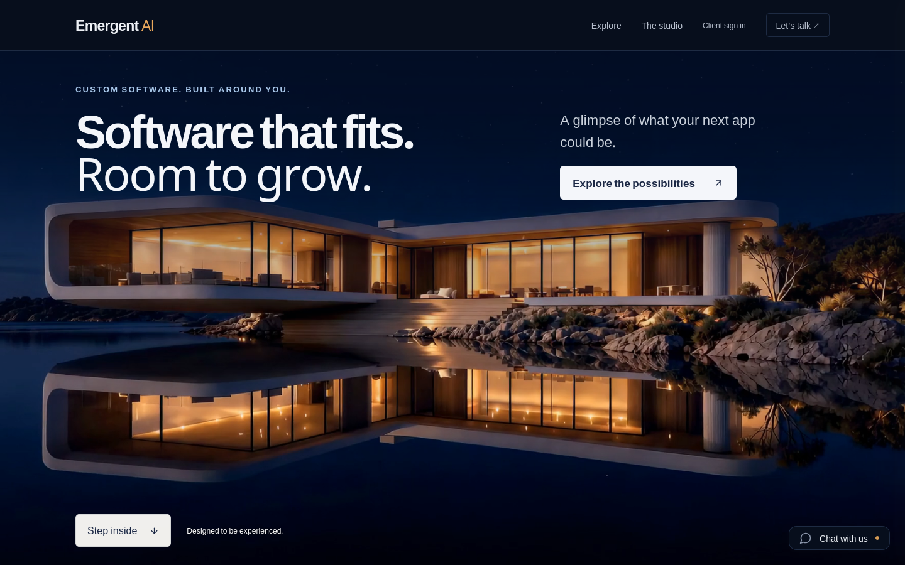
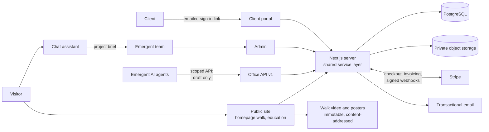
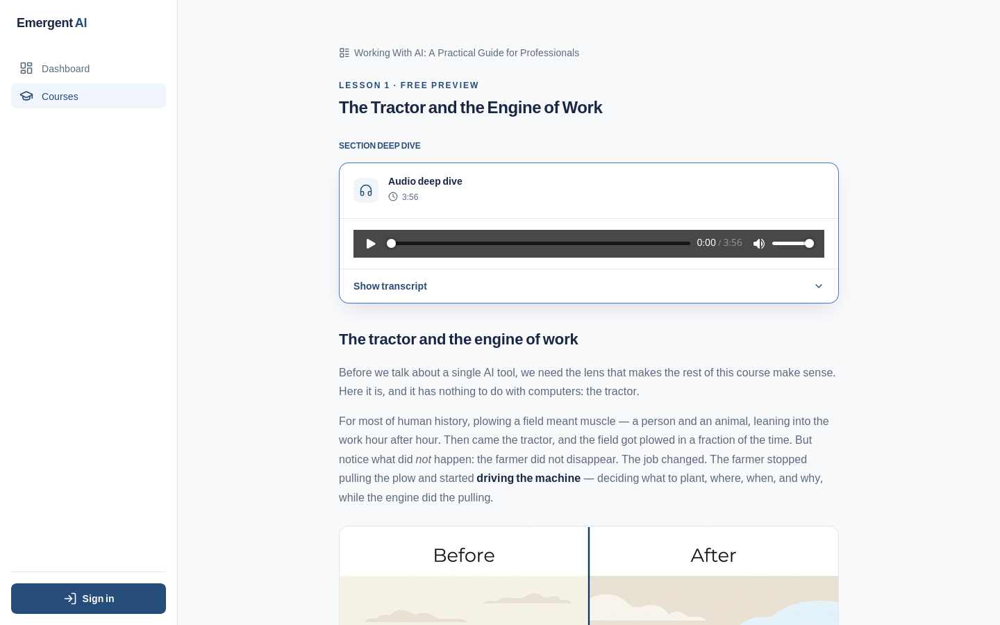

# Emergent: website and client portal

**Emergent AI Agency's own website and the client portal behind it: a homepage you walk into by scrolling, an AI assistant that turns a conversation into a project brief, and a portal where clients sign agreements, pay, track their projects and get their files.**

**Live:** [emergentaiagency.com](https://emergentaiagency.com)

---

## What it is

This is the system Emergent runs its own business on. The public half is the marketing site at emergentaiagency.com, whose homepage opens with a continuous camera walk across still water and into a house, driven entirely by the visitor's scroll. The private half is a client portal: once someone becomes a client, every agreement, payment, invoice, project update, file and message lives here, in one place they sign into with an emailed link.

It also carries a complete course platform (lessons, narrated audio, server-graded exams and numbered certificates), which Emergent runs on the same domain as working proof of what it builds.

## Highlights

- **A homepage you scroll through, not past.** The opening is three AI-generated video legs joined into one unbroken camera move. Scrolling down plays it forward, scrolling up plays it back, and the visitor sees the version that matches their own sky: morning, day, dusk or night, picked from their local clock before the first frame paints.
- **It holds up on phones.** Separate phone encodes, whole-clip preloading in walk order, and a seek watchdog that recovers when iPhone Safari stalls its video decoder. With reduced motion turned on, no video downloads at all; with JavaScript off, the whole page still works.
- **E-signatures built in, not bolted on.** Clients fill their own fields, read the merged document, give two separate consents (to sign electronically, and to the terms) and type their legal name. The server stores a SHA-256 fingerprint of the exact text signed, Emergent countersigns, and both sides get the executed PDF. PostgreSQL triggers stop anyone, including future code, from editing a signed document.
- **Money that matches what was agreed.** Payment schedules tie each amount to a stage of the work and only become payable once both sides have signed. Clients pay by card or US bank transfer through Stripe; partial payments, manual payments, refunds and disputes are all accounted for, and each Stripe event is recorded exactly once.
- **One honest home screen.** A signed-in client sees what they owe right now (one item, the most pressing), agreements waiting on them, their projects with progress, and what changed since their last visit. A bank payment still clearing is never shown as owed.
- **An AI assistant that writes the brief.** The chat on every public page talks with a visitor about how their business runs, then sends Emergent a structured project brief and the visitor a copy. Every conversation is kept for review in the admin.
- **A back office that agents can help with, safely.** A versioned API with scoped credentials lets Emergent's AI agents look up clients and draft invoices and agreements. Sending, approving and signing stay with a signed-in person, and stable work IDs stop the same hours being billed twice.

## The brief and the outcome

**What Emergent wanted from its own site.** Emergent sells software built around how a particular business runs, mostly to owners who are not technical. The site had to say that in plain words, with no jargon, and it had to *show* craft rather than claim it: the first screen is meant to feel like stepping into something made with care ("Designed to be experienced"). It needed to make three promises visible (a working sample before any commitment, the client owns what is built, and an idea can grow into a product), give a visitor an easy way to start talking at any hour, and point to something real that Emergent built and operates.

Behind the site, Emergent wanted to run each engagement without a stack of separate tools: no third-party e-signature service, no separate invoicing app, no shared folders for deliverables.

**What was delivered.**

- The scroll-walk homepage in four times of day, with the rest of the public site re-themed to follow the visitor's sky.
- An always-on chat assistant that qualifies the visitor and hands Emergent a written brief, plus a text line for people who would rather not type into a widget.
- The course platform on the same domain, with a free flagship course whose first lesson opens without an account.
- A full client portal and admin: clients and contacts, projects and services, agreements with native e-signature and payment schedules, hourly invoices with Emergent's own email and PDF, subscriptions, a revenue view with accounting export, and site statistics.

**What it changed.** A prospective client meets Emergent through an experience instead of a brochure, and if they go ahead, the same system carries them from signed agreement to paid invoice to delivered files. Emergent runs its own client work on the kind of system it builds for clients.

## Architecture

One Next.js application serves all of it: the public pages, the portal, the admin and the API. Pages and routes share one server-side service layer, so a rule such as "a signed agreement cannot change" or "a draft cannot be sent by an API credential" lives in one place no matter which door a request came through. PostgreSQL (through Prisma) holds the business records, and enforces the rules that matter most with constraints and triggers. Files, executed PDFs, certificates and course audio sit in private object storage behind ownership-checked downloads. Stripe collects payments; Emergent sends its own branded emails and PDFs.

The homepage walk is static media served from a CDN under content-addressed names, so the assets are cached for a year and a change always ships under a new name. The app is deployed on [HostKit](https://github.com/codeslayer44/hostkit-showcase), Emergent's in-house hosting platform.

A deeper walk-through, including how the scroll walk is generated and played, is in [docs/architecture.md](docs/architecture.md).

## Engineering notes

**The video walk is a pipeline, not a one-off.** Emergent extracted the homepage walk into a portable kit so it can be rebuilt for a client site. One approved opening still seeds the whole walk. Each short leg of motion is generated from the *actual last frame* of the previous leg, never from a separately drawn picture, because an image model's stills disagree in small details and a video model asked to pass through them visibly morphs the building. Hard transitions such as going through a doorway are split into two legs with the seam exactly on the door plane, so the model cannot cheat with a hidden dissolve. Small stalls at the seams are trimmed in assembly, guided by a measured motion curve, rather than paid for again. The headline is always live HTML over the video, never text baked into pixels.

**Scrubbing video smoothly is a seeking problem.** Scroll sets the video's playback position directly, so what matters is how fast a seek lands. The clips have no audio track and a keyframe every four frames on phones (eight on desktop). Each clip is downloaded whole and played from memory, so seeking never depends on the server supporting partial downloads. Every leg is preloaded at mount, one at a time in walk order, so the next leg is ready before the reader reaches it. Seeks are never stacked while one is in flight, and a seek still pending after 400 ms is recovered in escalating steps; that watchdog exists because iPhone Safari froze legs two and three as still images in real-device testing. The scrub engine started from the open-source scroll-world project (MIT) and was forked to live inside a normal page, clean up after itself, and survive those phone conditions.

**The signed text has one fingerprint, forever.** An agreement is rendered into a canonical text with a versioned format: dates as plain `YYYY-MM-DD`, money as whole cents, fields in a fixed sort order, and no locale formatting anywhere, so two machines in different time zones always produce the same SHA-256. Totals appear twice on purpose, so a partial edit cannot produce a self-consistent document, and any unfilled placeholder makes the document impossible to hash and therefore impossible to sign. Changing a signed agreement means superseding it with a new version the client signs again; paid installments carry forward.

**Payments are recorded exactly once, and charge exactly what was agreed.** Each Stripe webhook writes its ledger row and its business updates in a single transaction. If anything fails, Stripe is told to retry, and an event already in the ledger is acknowledged before any email goes out. Checkout prices come from the server, never the browser; an installment charges its remaining balance, refuses if nothing is owed, and an advisory lock prevents two open checkouts for the same installment.

**Built for agents to help, and not to overreach.** The Office API was designed for AI agents preparing paperwork. Every write needs an idempotency key, so a retry after a lost response returns the original result instead of a duplicate. Edits carry the revision they were based on, so an agent cannot overwrite a change made in the dashboard. Hourly lines can carry a stable work ID that is reserved across drafts and invoices, so the same work cannot quietly be billed twice. Credentials are scoped, rate-limited, stored only as hashes, and die when the admin who issued them loses admin rights.

## Tech stack

| Layer | Technology |
|---|---|
| Application | Next.js 16 (App Router), React 19, TypeScript |
| Styling and motion | Tailwind CSS 4, Framer Motion |
| Data | PostgreSQL, Prisma 7 (17 SQL migrations, including immutability triggers) |
| Auth | Better Auth with emailed sign-in links |
| Payments | Stripe Checkout, Invoicing, Billing Portal and signed webhooks; card and US bank account |
| Documents | React PDF for agreements, invoices and certificates |
| AI | Chat assistant with tool calls via OpenRouter; Gemini multi-speaker speech for narrated lessons; image generation in the course editor |
| Email | HostKit mail or Resend, with Emergent's own HTML layouts |
| Scroll walk | fal.ai image-to-video, ffmpeg scrub encodes, a forked scroll-scrub engine ported to TypeScript |
| Testing | Node test runner (unit), integration suites against real databases and Stripe test mode, Playwright end-to-end |
| Hosting | HostKit (Emergent's in-house platform), private object storage, CDN for walk media |

## By the numbers

| | |
|---|---|
| Commits | 486 (Mar 2026 to Oct 2026) |
| Lines of source | 86,617 |
| Tracked files | 1,165 |
| Test files | 35 |
| SQL migrations | 17 |
| API routes | 100 (counted in the source; 9 of them the Office API) |
| Portal and admin pages | 41 (counted in the source) |
| Languages | TypeScript 95.6%, HTML 1.3%, CSS 1.3% |

## Screenshots

**Free preview lesson from the Working With AI course**

## About this repo

The source for the site, the portal and the scroll-walk kit is private. This repository documents what the project is and how it is built, so it can be shown without publishing the code.

Related showcases: [HostKit](https://github.com/codeslayer44/hostkit-showcase), where this app runs; [NextAgent](https://github.com/codeslayer44/nextagent-showcase), Emergent's in-house agent control plane; and [FleetHarbor](https://github.com/codeslayer44/fleetharbor-showcase), the product the homepage points to as an idea that grew from one company's tool.

Built by [Emergent AI Agency](https://emergentaiagency.com) (Ryan Chappell). For questions or work enquiries, get in touch through emergentaiagency.com.
