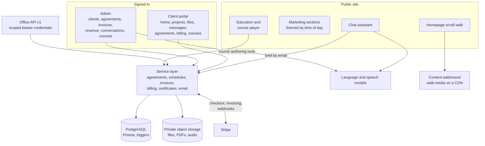
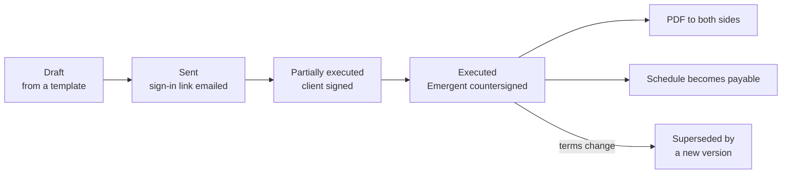

# Emergent site and portal: architecture

A deeper look at how Emergent's website and client portal are put together: the scroll-walk homepage and the pipeline that produces it, the portal's document and money model, the agent-facing API, and how the whole thing is tested. It describes the private codebase; no source is reproduced here.

## Design goals

1. **Show, don't claim.** The public site is itself the demonstration: a homepage that is experienced rather than read, and a course platform running on the same domain.
2. **One system per engagement.** Agreements, payments, invoices, projects, files and messages share one database and one set of rules, so the invoice knows the agreement and the payment knows the invoice.
3. **The database guards what matters most.** Rules whose failure would be expensive (a signed document changing, a payment recorded twice, work billed twice) are enforced by PostgreSQL constraints, triggers and transactions, not only by application code.
4. **Fail small.** A failing query costs one section of a page, not the page; a failed email never undoes a signature or a payment; a failed video leaves a still image and a working page.

## Components

Everything is one Next.js 16 application on the App Router. Route groups split the marketing pages from the portal, and the portal itself serves three audiences from one dashboard route, decided by two facts: whether the signed-in person has a client record, and whether that client has a project. A paying client gets the engagement status page; a new client with no project yet gets a first-run welcome (Emergent builds before it bills, so "nothing for you to do yet" is the honest screen); a learner gets the course dashboard.

## The homepage scroll walk

### What the visitor sees

The first screen is a full-viewport frame of a house on still water with the headline over it. Scrolling moves the camera across the water, through the door and into the room, as one unbroken shot. Scrolling back plays the same footage in reverse. The headline fades out as the walk begins and returns on the way back. When the walk ends, the stage releases and the page continues normally.

There are four versions of the walk: morning, day, dusk and night. A small script in the page head picks one from the visitor's local clock (sunrise and sunset are approximated per month), marks the page with it, and preloads that version's opening still before anything paints. The rest of the public site follows the same choice, with light themes for morning and day and dark ones for dusk and night. The portal and invoices keep their own fixed look.

### How the walk is made

The walk was produced with a reusable kit Emergent built for this purpose, so the same process can be run for a client site.

```mermaid
flowchart LR
    Still["One approved<br/>opening still"] --> Leg1["Leg 1<br/>image-to-video"]
    Leg1 -->|"actual last frame"| Leg2["Leg 2"]
    Leg2 -->|"actual last frame"| Leg3["Leg 3<br/>locked landing"]
    Leg3 --> Trim["Seam trims<br/>guided by motion curve"]
    Trim --> Relight["Relit into four<br/>times of day"]
    Relight --> Encode["Scrub encodes<br/>desktop and phone"]
    Encode --> Publish["Content-addressed<br/>publish and checksum"]
    Publish --> QA["Browser QA<br/>desktop and phone"]
```

- **One master still.** The opening frame is the only image fully art-directed. It sets the architecture, materials and light for everything after it, and it is iterated until approved before any motion is generated.
- **Legs chained by real frames.** Each leg is a short image-to-video generation (five to eight seconds) that starts from the frame the previous leg actually ended on, extracted from the rendered clip. Feeding the model several separately generated "waypoint" images was tried and rejected: those images disagree in small details, and the video model faithfully morphs between them.
- **Hard boundaries get their own seam.** A single leg asked to fly through a doorway tends to hide a dissolve instead. Splitting the move into two legs, with the handoff frame standing exactly in the door plane, puts the change of scene on a frame-exact cut where it cannot fade.
- **Locked landings.** When a leg must arrive somewhere specific, it is given an end frame from the same generation lineage, which also gives the model a destination to plan toward.
- **Seams fixed in post.** Legs slow slightly as they end. Instead of regenerating, the assembly trims each join, guided by a measured frame-to-frame motion curve, and the approved trim numbers become the recipe the encoder must reproduce.
- **Four skies, one camera path.** The chain is rendered once, upscaled once, and relit frame for frame into morning, day, dusk and night, so every version shares exactly the same motion and timing.
- **A ledger for every take.** Every generation, its checksum, the verdict on it and the final encode list are recorded in one file, and every file is checksummed at every hop from local disk to the CDN to the live page.

### How it plays

The player is a scroll-scrub engine: instead of playing the video, it sets the video's position from the scroll position on every animation frame. It began as a fork of the open-source scroll-world engine (MIT) and was ported to TypeScript for the site. Changes from upstream:

- **It lives inside a normal page.** The walk is a regular section whose height is the scroll runway; inside it a sticky full-viewport stage holds the scenes. All scroll maths is local to that section and clamped at both ends, so the final frame stays fully visible until the page releases it.
- **It cleans up after itself.** A `destroy()` stops the animation loop, removes listeners and video elements and frees memory, which matters in a single-page app where visitors navigate away without a full reload.
- **The page owns the words.** The engine only renders the moving picture and reports progress; the headline, buttons and skip link are ordinary page elements driven by that progress, so they stay accessible, selectable and editable.
- **Pace carries across seams.** Each leg's scroll runway is proportional to its duration, so the camera moves the same number of frames per screen of scrolling on both sides of every seam.

### Performance on phones

Scrubbing feels smooth only if seeks land quickly, and phones are where that breaks. The production setup:

- **Encodes built for seeking.** No audio track, and a keyframe every four frames in the phone encode (every eight on desktop), so any position is a short decode away. Phones get their own encode; they are detected by touch input or a narrow viewport.
- **Whole clips, played from memory.** Each leg is fetched in full and played from an in-memory copy, so seeking never depends on the server supporting partial downloads.
- **Preload in walk order.** All legs start downloading at mount, one at a time in the order they appear, so the first leg gets the bandwidth and the second is ready before the reader reaches it.
- **A seek watchdog.** New seeks are never issued while one is in flight. A seek that has not landed after 400 ms is recovered in steps: re-issue it, then nudge the video pipeline with a muted play and pause, then reload the clip. Heavy recovery runs only on the visible leg. This came from real-device testing, where iPhone Safari dropped its decoders under the load of several videos and left later legs frozen as stills.
- **Touch priming, one clip at a time.** iOS will not paint a video that has never played, so the first touch quietly plays and pauses each clip, sequentially rather than all at once.
- **The poster stays up until a real frame paints**, and mobile address-bar resizes are ignored so the scroll position never jumps.
- **Graceful fallbacks.** With reduced motion on, no video is fetched and the page shows a single still with no scroll runway. Without JavaScript the whole page and its contact routes still work. If the video fails to load, the poster and a skip link remain.
- **Immutable media.** Every walk asset is published under a name that includes part of its checksum, so it can be cached for a year and a change always arrives under a new name.

## The client portal

### Signing in

Clients sign in with an emailed link. Corporate mail scanners open every link in an email seconds after it arrives, which used to spend the one-time link before the client could click it. Links now land on a confirmation page that consumes nothing; only pressing its button signs the person in. Admins can add other sign-in addresses to a client, so a link requested from a second address signs into the same client account.

### Home screen

The client home answers four questions in order: what do I owe, what is waiting for my signature, how are my projects going, and what changed since I was last here.

- **What I owe** comes from two different systems (hourly invoices and installments on a signed payment schedule) and is reduced to one item, the most pressing, plus a count of the rest. A bank payment that is still clearing is not owed, a partly paid invoice shows only its remaining balance, and a client with no billing history sees nothing at all rather than a misleading "paid up".
- **What is new** uses a visit baseline instead of a single "last seen" timestamp: the start of the current visit is fixed, so every page in the visit agrees on what is new. A visit ends after 30 minutes idle, and the heartbeat is written at most once every five minutes.
- Each section loads independently, so one failing query costs one section rather than the whole page.

Projects have an overview with progress, a file area backed by private storage, and a message thread. Clients can also update their name and the address notifications go to.

### Agreements and electronic signature

Each agreement is a stable record with numbered versions underneath it. The client fills the fields they own (Emergent's fields are locked), reviews the merged document, opens the electronic-signature disclosure, gives two separate consents and types their legal name. The signature record keeps the typed name verbatim, both consent times, the account, the time, the request's network details as observed by the server, and the fingerprint of the canonical text. Emergent countersigns with the same steps. Only then is the PDF rendered, stored privately and emailed to both sides.

The canonical text has a versioned format so old fingerprints stay verifiable if the format ever changes. Signing links are single-purpose, expire, can be revoked, are stored only as hashes, and authorize a ceremony on top of a signed-in session, never instead of one. Notifications go out after the transaction commits, so a mail failure cannot undo a signature.

### Payment schedules and payments

A payment-schedule agreement lists installments, each tied to a stage of the work and what that stage delivers. The signed document is rendered from a frozen snapshot of those installments; the live installment rows that carry payment state are bound to the snapshot by a per-row digest, and database triggers freeze their amounts once the agreement is executed. A schedule becomes payable at countersignature, and the first payment request is a separate, deliberate admin action.

Clients pay through Stripe Checkout by card or US bank account. Manual payments can be recorded by an admin. Checkout always charges the remaining balance, refuses when nothing is owed, and holds a per-installment lock while it replaces any still-open session. Ongoing services are Stripe subscriptions with their price set from the terms Emergent assigned, and clients manage them in Stripe's billing portal.

### Invoices

Hourly invoices are Emergent's own documents: Emergent renders the email and the PDF in its house style, and Stripe only collects the money. Amounts are integer cents with exact half-up rounding per line. Sending, resending and voiding require a signed-in admin. Each invoice is reconciled against Stripe's full state, including refunds, disputes and late fees, and the admin shows who received each email.

### Webhooks and the ledger

Every Stripe event is verified by signature and recorded in a payment ledger in the same transaction as the business change it causes. Failures return an error so Stripe redelivers; events already in the ledger are acknowledged immediately. Stripe reads happen before the transaction and emails after it commits.

## The Office API

A versioned HTTP API (`/api/v1`) lets Emergent's AI agents do the paperwork side of the business without holding the keys to it.

| Scope | What it allows |
|---|---|
| Invoices read and write | List and read invoices and billed work; create and edit drafts |
| Agreements read and write | Read agreements and templates; create and edit drafts and document templates |
| Clients read | Exact client lookup and eligible contacts |

What it cannot do, by design: send, approve, sign, countersign, void, supersede, issue signing links, create clients, manage credentials, or reach the admin routes. A person reviews every draft in the dashboard and sends it.

Conventions shared by every endpoint:

- **Idempotency keys** on every write. The saved response commits in the same transaction as the change, so a retry after a lost response returns the original result, and the same key with a different body is refused.
- **Optimistic revisions.** Edits name the revision they started from; a draft changed in the dashboard or by another agent returns a conflict instead of being overwritten.
- **Billed-work claims.** Invoice lines can carry a stable work ID from the agent's timesheet. The claim is reserved while the draft exists, kept when issued and paid, and released on void, so the same work cannot be billed twice.
- **Guard rails.** Strict validation that rejects unknown properties, a request size limit, a per-credential rate limit kept in the database, no-store responses, a request ID on every response, and a uniform error envelope. Credentials are random, stored only as hashes, optionally expiring, revocable, and stop working when the admin who issued them is no longer an admin.

## The chat assistant

Every public page carries a chat assistant that runs on a tool-calling language model. It reads whether it is talking to a business owner or a learner, asks one question at a time, and keeps to the site's plain voice. When it understands how a visitor's business runs, it sends Emergent a structured brief (what was heard, how Emergent could help, questions to explore, and an internal fit assessment) and can send the visitor a copy written as a follow-up note. Visitors who just want to leave their details can do that instead. Conversations are logged and readable in the admin.

## The course platform

Courses are built from sections and lessons, with inline images and a two-host narrated "deep dive" for each course. The narration is produced from a script by multi-speaker speech synthesis in small, retryable chunks, joined, encoded to MP3 and stored privately; long jobs run in the background while the editor polls for status, and a failed run never replaces a working recording. Exams are graded on the server (70% to pass, unlimited retakes). A first pass issues a numbered certificate: numbering is unique per year and safe under concurrent passes, the PDF is rendered and stored, and the learner is emailed a link. A certificate failure never affects the exam result and can be retried.

## Testing

| Suite | What it covers |
|---|---|
| Unit (Node test runner) | Formatting, invoice access and documents, invoice emails and PDFs, visit tracking, request validation, checkout pricing, payment maths, and the canonical agreement format |
| Integration | The agreements API, client contacts, both checkouts against Stripe test mode, and every webhook event type for atomicity and retry, each against a throwaway database |
| End-to-end (Playwright) | The homepage walk (clips seek through all three scenes, reverse scroll, reduced motion, no JavaScript, video failure), mobile navigation and focus, theme isolation between pages, and the anonymous and learner course funnels |

The repository holds 35 test files. Each integration suite creates its own database, loads the schema, and drops it afterwards.
